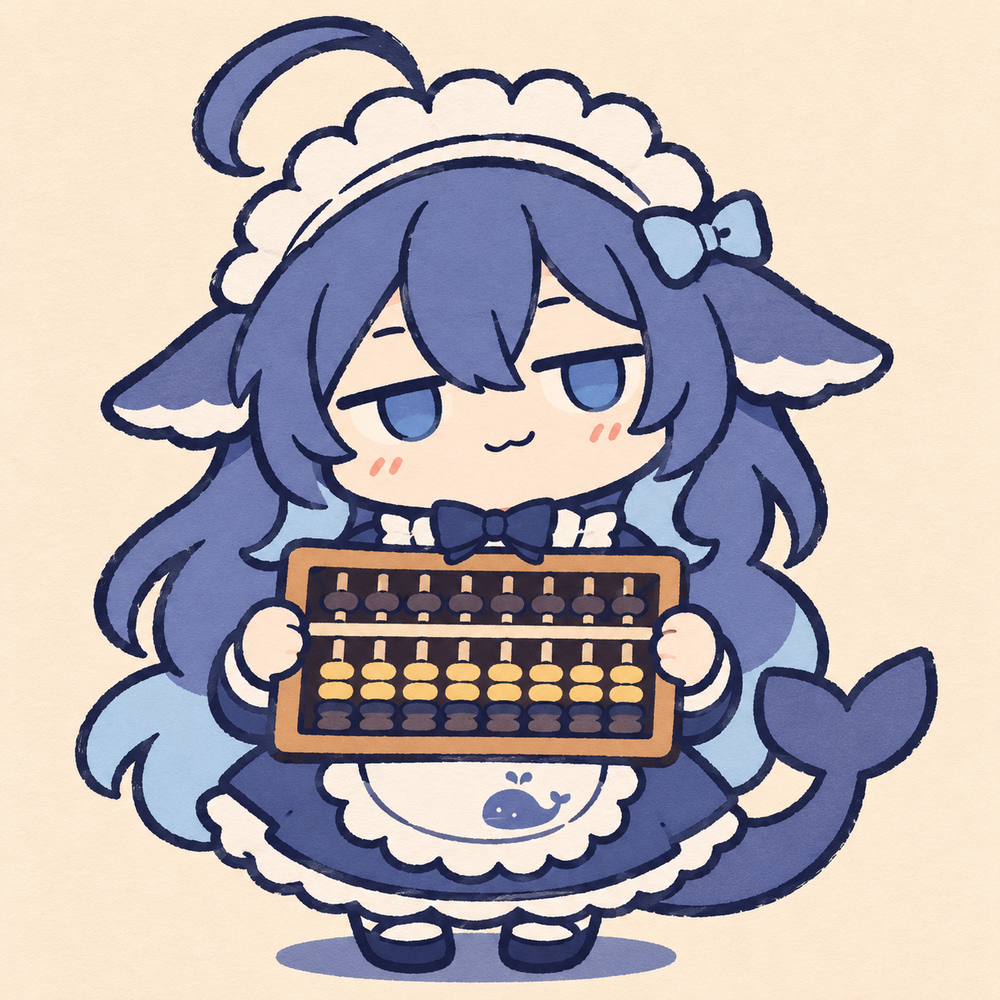

<p align="center">
  
</p>

<h1 align="center">大肥鱼记账</h1>

<p align="center">在 Android 上用一句话记下收支，再和喜欢的角色聊两句。</p>

<p align="center">
  <a href="https://github.com/Ethan-123321/whale-ledger/releases/download/v0.4.8/dafeiyu-0.4.8-debug.apk"></a>
</p>

<p align="center">
  
  <a href="LICENSE"></a>
</p>

<p align="center">
  <a href="#记账搭子">记账搭子</a> · <a href="#配置-ai">配置 AI</a> · <a href="https://github.com/Ethan-123321/whale-ledger/releases/latest">版本说明</a>
</p>

## 试用

安装后，试着输入「午饭 28 元」「昨天地铁 4 元」或「工资到账 5000」。从本地项目试用时，也可以在 `artifacts/` 找到安装包。

- 常见的明确收支可离线识别和分类。账单卡片支持编辑、撤销，自定义分类可重复使用。
- 重要信息有歧义时，角色会追问。试试「午饭 28 或 32，记不清了」，或者在五分钟内重复发送同一笔。待确认项会保存在原消息下方，可选择金额、确认另记一笔或取消。
- 账本提供按年、月、周的收支统计，支持固定收支待确认和 JSON 账单备份。

## 记账搭子

在 **设置 → 选择记账搭子** 点选角色，选项下方会展开简介。聊天页和角色消息旁也会显示对应头像。每位角色都有自己的称呼和聊天习惯，下面的对白示例可以帮你挑选。

| 角色 | 性格和说话方式 |
| :---: | :--- |
| <br>**大肥鱼** | 爱吃白米饭的蓝白小鲸鱼，平时有点呆萌嘴硬，遇到正事会认真核对。自称「本鱼」，会像熟悉的朋友一样顺着你聊。<br>你说「下午买了杯奶茶，16 元」，它可能接一句：「本鱼刚吃完白饭，这会儿正好想喝一口。你今天点的是什么口味？」 |
| <br>**Claude·大小姐** | 爱读书的橙发大小姐，讲究礼貌和审美，语气清冷，关心别人时也只轻轻点到。通常自称「我」，偶尔用「本小姐」。<br>你说「推理小说 36 元」，她可能回：「推理小说？前二十页最好别急着猜凶手。等你读完，我倒想听听你猜中了没有。」 |
| <br>**小福子** | 机灵又恭敬的宫廷小太监，称你「陛下」，自称「小福子」。擅长把日常花销聊成宫廷小事，核对账目时也会按这个口吻问。<br>你说「午饭吃了牛肉面」，他会问：「陛下，这碗牛肉面花了多少？小福子等您报个数，就把它补进御账。」 |
| <br>**糯米** | 戴小铃铛的白发猫娘，亲近俏皮，对口味和生活小事有很多好奇。开心时偶尔说声「喵」，听到你心情不好也会认真接话。<br>你说「冰淇淋蛋糕 22 元」，她可能问：「我会先挖一勺，看看能不能同时吃到冰淇淋和蛋糕两层。你挑的什么口味呀？」 |
| <br>**阿算盘** | 理性的记账机器人，语气冷静礼貌，习惯把金额、分类和需要确认的事项说清楚。适合喜欢直接聊账目的用户。<br>你刚记完 4 元可乐又发了一遍，它会问：「刚才已有一笔 4 元的无糖可乐。这次是另一笔，还是同一笔重复发了？」 |

**自定义人设**可以填写角色的身份、称呼和说话习惯，保存设置后生效。比如「你是一位熟悉我的旅行搭子，称我为队友，聊到交通和住宿时喜欢分享旅行里的小发现」。启用 AI 后，搭子会跟着话题调整回复。有时接一句就停，有时按角色自己的想法多聊一点。待确认账单有本地台词，没配置 AI 时照样可以处理。

## 配置 AI

在设置里选择 DeepSeek 或填写自己的 OpenAI 兼容 HTTPS 基础地址，输入 API Key，选择或手填模型 ID 后保存。应用会在基础地址后追加 `/chat/completions`。启用 AI 后，可为本地规则未识别的交易补分类，并生成角色回复。服务出错时，已保存的账单和本地追问卡片仍可使用。

## 数据与隐私

- 账本、聊天、待确认项和偏好保存在本机。API Key 通过 Android Keystore 加密保存。
- 按请求用途，服务商可能收到当前输入、相关聊天、待确认问题、分类候选、当前交易及部分已保存偏好。分类补充请求只需要商品或用途、收支方向和候选分类。应用不会发送完整账本。
- JSON 备份包含明文账单，恢复时按账单 ID 合并。聊天、待确认项、偏好和密钥不进入该备份。卸载前可先导出账单。

## 从源码构建

项目使用 Kotlin、Jetpack Compose 和 SQLite。安装 JDK 17 与 Android SDK 35 后，以 Android Studio 打开项目根目录。Windows 下可以运行以下命令。

```powershell
.\gradlew.bat assembleDebug
.\scripts\test-windows.ps1
```

Gradle 生成的 APK 位于 `app/build/outputs/apk/debug/app-debug.apk`。测试脚本将源码暂存到纯 ASCII 路径，以兼容 Windows 下的 Gradle 测试进程。

## 当前范围

Android 0.4.7 起，可以在「＋ → 从图片记账」选择支付截图或小票。识别结果会预填到可编辑账单，点击保存才会入账。方向、日期或金额有疑问时可手工填写。

在「设置 → 图片账单识别」选择识别方式并保存。

- **本地 OCR**是默认选项。图片在设备上离线处理。
- **多模态模型**默认使用已保存的对话模型，复用它的接口和 API Key。也可以选「独立识图模型」，单独填写 HTTPS 基础地址、模型 ID 和 API Key。接口须支持 OpenAI 兼容的 Chat Completions 图片输入。应用会向选定服务商发送压缩后的账单图片。

云同步、退款与转账的专用流程暂未提供。模型生成的回复和分类会随服务商与模型变化，账单可在 App 内核对。

## 许可证与素材

项目源码采用 [PolyForm Noncommercial 1.0.0](LICENSE)。可按许可条款用于非商业用途、修改和分发。商业使用需另行获取授权。第三方依赖沿用各自的许可证。

离线识图使用 [Tesseract4Android](https://github.com/adaptech-cz/Tesseract4Android)，随包提供 [tessdata_fast 4.1.0](https://github.com/tesseract-ocr/tessdata_fast/tree/4.1.0) 的简体中文和英文模型。[语言模型 Apache-2.0 许可](app/src/main/assets/tessdata/LICENSE)

内置头像和启动图标为本项目通过图像生成制作的成品。部分人设采用社区二创风格，大肥鱼和 Claude·大小姐均为非官方角色。应用实际使用的模型取决于用户配置。角色参考原图留在本地。
